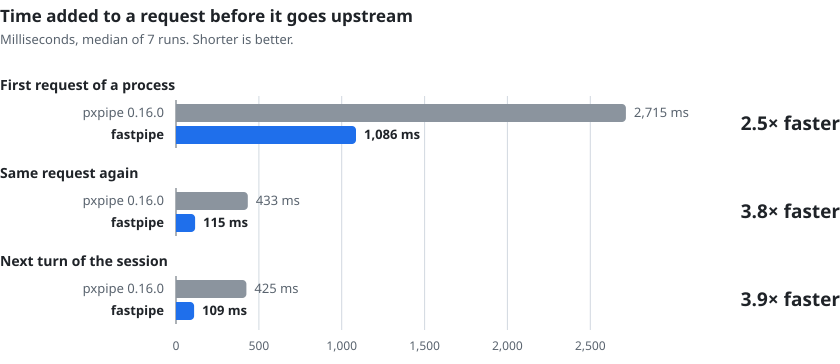
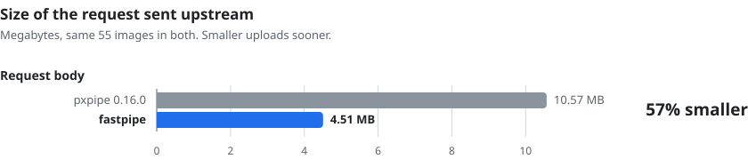
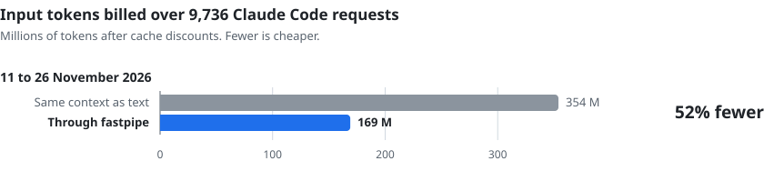

<p align="center">
  
</p>

<p align="center"><b>pxpipe, up to 3.9 times faster. Same pixels.</b></p>

<p align="center">
  <a href="https://www.npmjs.com/package/fastpipe-proxy"></a>
  <a href="LICENSE"></a>
  <a href="#install"></a>
  <a href="tsconfig.json"></a>
  <a href="#commands"></a>
  <a href="https://github.com/teamchong/pxpipe"></a>
</p>

<p align="center">
  <a href="#commands"></a>
  <a href="#commands"></a>
  <a href="#commands"></a>
  <a href="#commands"></a>
</p>

<p align="center">
  <a href="#install">Install</a> |
  <a href="#commands">Commands</a> |
  <a href="#what-the-fork-changes">What the fork changes</a> |
  <a href="#benchmarks">Benchmarks</a> |
  <a href="docs/pxpipe.md">pxpipe guide</a> |
  <a href="SECURITY.md">Security</a>
</p>

<p align="center">
  <picture>
    <source media="(prefers-color-scheme: dark)" srcset="assets/bench-latency-dark.svg">
    
  </picture>
</p>

<table align="center">
  <tr>
    <td align="center"><h3>3.9×</h3>faster per turn</td>
    <td align="center"><h3>57%</h3>smaller requests</td>
    <td align="center"><h3>52%</h3>fewer input tokens than text</td>
  </tr>
</table>

fastpipe is a fork of [pxpipe](https://github.com/teamchong/pxpipe) 0.16.0 by teamchong. It sends the bulky parts of a coding agent's context as images, which cost fewer input tokens than the same text. The method and the model evaluations are pxpipe's, and the [pxpipe guide](docs/pxpipe.md) explains them.

## Install

```bash
npm install -g fastpipe-proxy
fastpipe on
```

Node 20.19 or later. Open a new Claude Code session after `fastpipe on`.

To upgrade: `npm install -g fastpipe-proxy@latest`, then `fastpipe restart`.

<details>
<summary>Build from source</summary>

```bash
git clone https://github.com/rospocroccante/fastpipe
cd fastpipe
pnpm install
pnpm run build
node scripts/fastpipe-ctl.mjs install   # copies the build to ~/.fastpipe/app and adds the fastpipe command
fastpipe on
```

</details>

Imaged with nothing set: Fable 5, Opus 5.5 and Gemini (default `PXPIPE_MODELS=claude-fable-5,claude-opus-5-5,gemini`). Other models pass through as text. Validated on Fable 5, Gemini 3.6 Flash and Gemini 3.7 Flash. [Measurements per model](docs/pxpipe.md#the-honest-part).

## Commands

```bash
fastpipe on        # start the service and hook Claude Code
fastpipe status    # what is running, hooked and paused
fastpipe pause     # pass every request through untouched
fastpipe resume    # transform again
fastpipe restart   # load a newly installed build
fastpipe off       # unhook Claude Code and stop the service
fastpipe direct    # one Claude Code session straight to Anthropic
```

- Other agents: `fastpipe warp -- opencode`, `fastpipe warp -- codex`, `fastpipe warp -- agy`. See the [pxpipe guide](docs/pxpipe.md).
- A watchdog unhooks Claude Code when the proxy stops answering and hooks it back when it returns.
- Runs under launchd, the systemd user manager, or as a background process with a login entry. `FASTPIPE_SERVICE=launchd|systemd|process` overrides the choice.
- Daily use so far on macOS only. Linux and Windows are covered by the tests.

## Dashboard

<http://127.0.0.1:47821/>. The saving first, the detail behind one button.

## What the fork changes

- Palette PNGs, cached base64 and factsheet, pages rendered in parallel. Same pixels.
- `fastpipe on` and `fastpipe off`, with a watchdog and a pause switch.
- Dashboard: saving, money, cost per request, the images sent.
- One retry on a dropped connection.
- Tool changes survive history collapse. No more `tool_reference_unresolved`.
- Refused requests are not written to disk. `FASTPIPE_DEBUG_CAPTURE_4XX=1 fastpipe on` turns capture on.
- Listens on `127.0.0.1`. Data stays in `~/.fastpipe`.

Detail in the [changelog](CHANGELOG.md).

## Benchmarks

### Local transform

One synthetic long Claude Code session: 200 tool-call turns, 40 tools, 1.02 MB of JSON, 55 pages on `claude-fable-5-2`. Median of 7 runs, fresh process each, Apple M4 Pro, Node 24.22.

| | pxpipe 0.16.0 | fastpipe | Change |
|---|---:|---:|---:|
| First request of a process | 2,715 ms | 1,086 ms | 2.5 times faster |
| Same request again | 433 ms | 115 ms | 3.8 times faster |
| Next turn of the session | 425 ms | 109 ms | 3.9 times faster |
| Request body sent upstream | 10.57 MB | 4.51 MB | 57% smaller |
| Images in the request | 55 | 55 | same |

<p align="center">
  <picture>
    <source media="(prefers-color-scheme: dark)" srcset="assets/bench-body-dark.svg">
    
  </picture>
</p>

Same JSON and same pixels on five model profiles, checked by `bench/equivalence.mts`. Images are billed on pixel size, so the bill stays the same.

Other profiles, first request: `claude-fable-5` 2,684 to 1,103 ms, `gemini-4-argon` 2,700 to 1,110 ms.

Local work only. The time the provider takes to read the images is unchanged.

Run it yourself:

```bash
git remote add upstream https://github.com/teamchong/pxpipe
git fetch upstream --tags
git worktree add ../pxpipe-0.16.0 v0.16.0
ln -s "$PWD/node_modules" ../pxpipe-0.16.0/node_modules

npx tsx bench/latency.mts ../pxpipe-0.16.0     # pxpipe
npx tsx bench/latency.mts .                    # fastpipe
npx tsx bench/equivalence.mts ../pxpipe-0.16.0 # same JSON, same pixels
node bench/charts.mjs                          # redraw the charts
```

### Real use

<p align="center">
  <picture>
    <source media="(prefers-color-scheme: dark)" srcset="assets/bench-tokens-dark.svg">
    
  </picture>
</p>

One machine, 11 to 26 November 2026. 9,736 requests, 9,545 imaged.

The text figure is the proxy's own count on the same requests, with no second run without the proxy. The saving is pxpipe's method, and the fork leaves it as it is.

## Licence

MIT, as pxpipe. See [LICENSE](LICENSE). The bundled fonts keep their own licences, in `assets/`.
